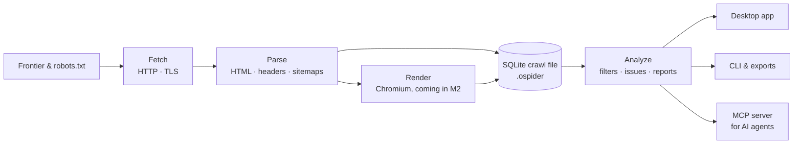

<p align="center"></p>

<h1 align="center">OpenSpider</h1>

<p align="center"><b>The crawler for the agentic era.</b><br>
Open-source website crawler and technical SEO auditor – built for AI agents and humans alike.</p>

<p align="center">
  <a href="https://github.com/domdewom2/openspider/actions/workflows/ci.yml"></a>
  <a href="LICENSE"></a>
  
  
  
  
</p>

<p align="center">
  <a href="https://openspider.de">Website</a> ·
  <a href="docs/ARCHITECTURE.md">Architecture</a> ·
  <a href="docs/spec">Specification</a> ·
  <a href="#roadmap">Roadmap</a>
</p>

---

OpenSpider crawls websites the way a search engine does and finds the technical SEO problems that cost rankings: broken links, redirect chains, canonical and hreflang errors, indexability conflicts, duplicates, thin content and much more.

What makes it different: **AI agents are first-class users.** A built-in MCP server lets Claude, Codex, Cursor and other agents start crawls, ask precise questions about the results and run full audits – safely, with read-only defaults and cost guards. And every crawl is an open SQLite file, so your data never gets locked into a proprietary format.

## Why OpenSpider?

| | |
|---|---|
| 🤖 **Agent-native** | Built-in MCP server (STDIO and authenticated local HTTP). Tools are grouped into `read`, `crawl`, `write` and `cost` classes – only `read` is enabled by default. Crawled content is treated as untrusted data, never as instructions (prompt-injection safe outputs). |
| 🐘 **Built for large sites** | Disk-first storage with constant memory and crash-safe resume. **Measured: 1 million URLs in about 4.5 minutes at ~3,600 URLs/s with under 0.5 GB RAM** (Apple M2, synthetic site with 30 links per page). |
| 📂 **Open data** | One plain SQLite file per crawl (`.ospider`). Query it with SQL, Python, DuckDB, Excel or any BI tool – no export step needed. |
| 🔍 **Complete technical SEO** | Status codes, redirects, canonicals, hreflang, directives, robots.txt, sitemaps, duplicates, content, images, links, pagination, security headers, structured data – with filters, issue explanations, reports and exports (CSV/XLSX). |
| 🆓 **Free, no limits** | Apache-2.0. No URL cap, no license key, headless CLI and scheduled crawls included – perfect for CI/CD pipelines. |
| ⚡ **Native and fast** | Rust core, Tauri desktop app, small installers for macOS (Apple Silicon & Intel) and Windows. |

## Quick start

> OpenSpider is in active development. There are no installers yet – the headless CLI and the MCP server already work when built from source. The desktop app is coming with the alpha.

```bash
git clone https://github.com/domdewom2/openspider.git
cd openspider
cargo build --release -p os-cli          # binary: target/release/openspider
```

**Crawl a site and export results**

```bash
openspider --crawl https://example.com --headless \
  --output-folder ./out --export-tabs "Internal:All" --save-crawl
```

**Crawl a list of URLs or a sitemap**

```bash
openspider --crawl-list https://example.com/sitemap.xml --headless --output-folder ./out
```

**Work with saved crawls**

```bash
openspider --list-crawls --json
openspider --load-crawl <crawl-id> --headless --output-folder ./out --export-tabs "Internal:HTML"
openspider --help export-tabs            # all valid tab:filter names
```

## Use it from your AI agent

OpenSpider prints ready-to-paste MCP configurations for popular clients:

```bash
openspider mcp --print-config claude-code     # also: claude-desktop, codex, cursor
```

Then just ask your agent, for example:

> *“List my OpenSpider crawls, show the overview of the latest one and explain the five most important issues with example URLs.”*

Read-only tools available today: `list_crawls`, `crawl_overview`, `list_issues`, `query_urls`, `url_details`. Crawl control, a Claude Code plugin with slash commands (`/openspider-audit`, `/openspider-compare`, `/openspider-issues`) and a skill follow in the next milestone.

## Your crawl is a database

```bash
sqlite3 example.ospider \
  "SELECT address, status_code, title_1 FROM urls
   WHERE is_internal = 1 AND status_code >= 400
   ORDER BY address LIMIT 20;"
```

The file format is documented and versioned, so scripts and dashboards keep working across releases.

## How it works



A Cargo workspace of focused crates (`os-fetch`, `os-parse`, `os-render`, `os-store`, `os-engine`, `os-analyze`, `os-export`, `os-mcp`, `os-cli`, …) with a Tauri v2 + React desktop app on top. Details: [docs/ARCHITECTURE.md](docs/ARCHITECTURE.md).

## Roadmap

| Milestone | Content | Status |
|---|---|---|
| **M1** | Crawl core, storage, CLI, MCP (read-only), core analyses | ✅ done |
| **M2** | Desktop app, all analysis tabs, reports, JavaScript rendering, Google APIs | 🚧 in progress – alpha planned for late October 2026 |
| **M3** | Signed installers, auto-update → **1.0** | planned |
| **M4** | AI features: page classification, optimization suggestions, “ask your crawl”, AI search visibility (Claude, OpenAI, OpenRouter, Ollama) | after 1.0 |
| **M5** | External SEO data (keywords, backlinks, SERP, LLM mentions) | after 1.0 |

OpenSpider stays fully usable without any account. AI and external data features will work with your own API keys or local models. More: [roadmap after 1.0](docs/plan/ROADMAP-nach-1.0.md).

## Built with AI agents

OpenSpider is developed by a team of AI agents: Claude Opus plans the architecture and work packages, Claude Sonnet and OpenAI Codex implement them, and Claude Fable reviews every package and accepts each milestone against the specification. Every function references its spec ID in tests (`// spec: ONPAGE-012`), and parity and performance are measured continuously in CI on macOS, Windows and Linux.

## Contributing

Issues and ideas are welcome. Please read [CLAUDE.md](CLAUDE.md) first – it contains the rules every contributor (human or agent) follows: work from the specification in [`docs/spec`](docs/spec), tests with spec IDs, green `fmt`/`clippy`/tests before every commit, and only permissively licensed dependencies.

## License

Apache-2.0 – see [LICENSE](LICENSE).

The OpenSpider name and logo (`assets/brand/`) are not covered by the Apache-2.0 license; please do not use them to brand forks or derived products without permission.
