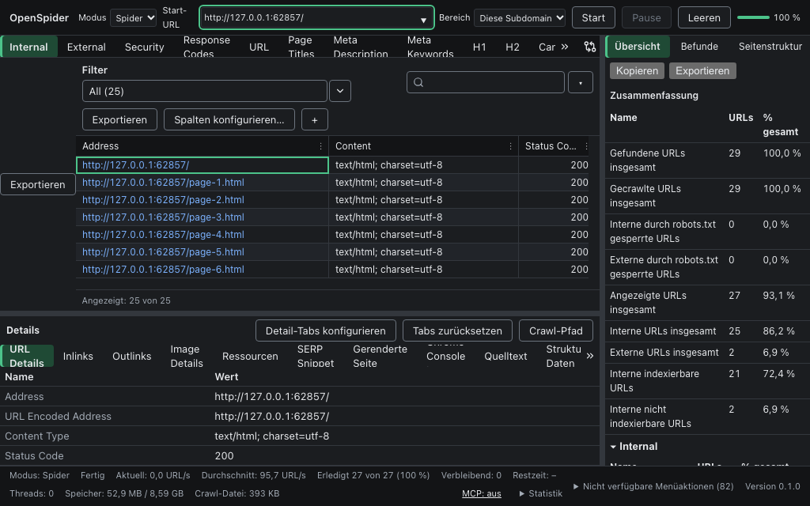
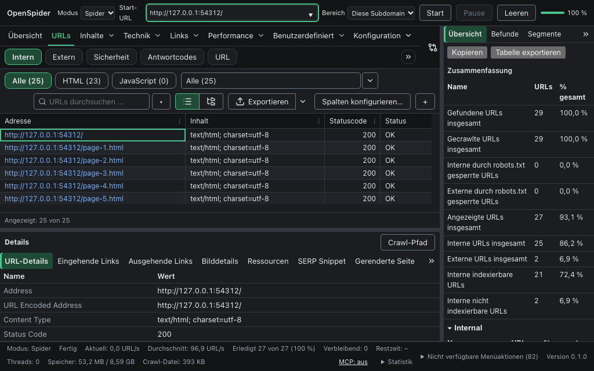
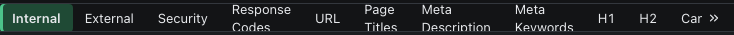
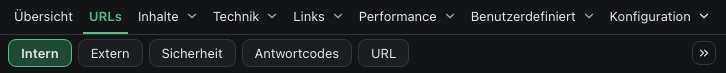
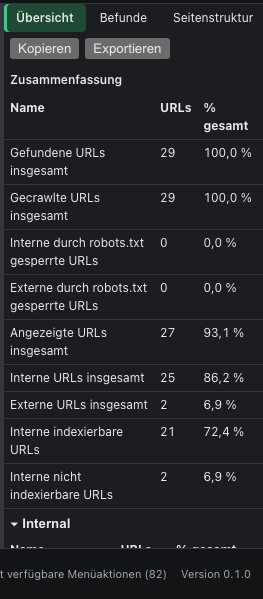
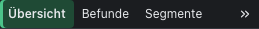

# M2-U34 – Paketbericht (UI-Feinschliff nach der Beta-Abnahme)

Stand 28.10.2026, Branch `m2/u34` (von `m2/plan-k275a` @ `e6700aec`), lokale Claude-Code-Session auf dem Haupt-Mac (macOS, Apple
Silicon, Node 22), Modell Claude Opus 5.5. Clean-Room: ausschließlich `docs/spec/{05-ui,06-output-ops}.md`, `docs/plan/M2.md`,
`docs/plan/M2-ui-concept.md` (Abschnitt 5), die Befundliste `docs/plan/M2-acceptance/beta/befunde.md` und der vorhandene Code; kein Blick auf
das Referenzprodukt, keine fremden Texte, Bilder oder Layouts. Kein Push, kein Merge, kein PR (Orchestrator holt den Branch ab).

**Ergebnis:** Alle Befunde der Arbeitsliste (A02-01 … A02-06, A02-17, A02-19, A02-21) sind behoben und durch vitest- und E2E-A-Tests mit
Spec-ID abgedeckt. Frontend-Prüfungen und die E2E-A-Ordner `polish`, `export`, `table-advanced`, `alpha` sind lokal auf Chromium und WebKit
grün (Abschnitt „Prüfungen“). Die CI-Matrix (macos-14 WebKit, windows-latest Chromium) ist nicht gelaufen, weil der Branch nicht gepusht wird.
Englische Resttexte bleiben in Bereichen außerhalb der owns (Übersicht/Befunde der Seitenleiste, URL-Details-Feldnamen, Namen der Bulk-Exporte
und Berichte); sie sind unten als Befunde an den Planer aufgeführt.

**Commits** (`git log e6700aec..m2/u34`): `72cec8f1` gemeinsame Tab-Leiste · `6d7df192` ein „Exportieren“ · `e78cc988` Tab-/Filter-/Spaltennamen
de · `28068f63` Mehrfach-Export nach OUT-075 · `ee274cde` Segmente und Rendering-Hinweis · `7b80f68d` Tab-Leisten stabil, Esc, E2E Tab-Leisten ·
`f8a5559b` Begriffsliste, E2E Sprache/Layout · `1420d51d` Alpha-Erwartung „Export…“ · `1b69f3c7` ResizeObserver je Leiste · `e361627e` Enter wählt
Tab, Tests Überlaufmenü/Ellipse · `dd94e4e7` Alpha-Zugriffshilfen über das Überlaufmenü · `4297f77f` Bericht · `fc604b92` Merge Plan K2-77 ·
`5fffec35` gruppierte Navigation und Pillen · `fb6b72a1` Filter-Chips, Liste/Baum, „Exportieren ▾“ · `59b64611` E2E Gruppen/Sprache · `74277309`
Alpha `selectTab` über Gruppe · `ed0d51a4` Tab-Zeilenhöhe im Layout, Pfeiltasten, keine Überlappung · `354491c6` Menü ohne doppelte IDs ·
`3c4f4b87` Tab-Tests je Gruppe, Seitenleisten-Export · `0a10f1a1` Rundung der Tab-Breiten, U10-Test-Reihenfolge · danach Bericht/Screenshots.

## Befunde der Arbeitsliste

| Befund | Ursache | Änderung | Test (Spec-ID) | Stand |
|---|---|---|---|---|
| **A02-01** Haupt-Tab-Leiste: zweizeilige Beschriftungen unten gekappt | `.os-tab` hatte eine feste Höhe von 28 px ohne `white-space: nowrap`; lange Namen brachen um, die zweite Zeile lag außerhalb der Box. | Gemeinsame `TabBar` (`ui/primitives/TabBar.tsx`) mit einzeiliger Beschriftung, Mindesthöhe statt fester Höhe, Ellipse und Tooltip (`title` = voller Text) für zu lange Namen; Stile in `features/shell/tabbar.css`; Zeile der Top-Tabs im Raster `minmax(28px, auto)` (`features/shell/shell.css`). | vitest `primitives.test.tsx` (UI-004 [P1]); E2E `e2e/polish/tabbars.spec.ts` (UI-004 [P1], UI-001) | behoben |
| **A02-02** Detail-Tab-Leiste: „Chrome Console Log“ oben gekappt, zweizeilige Labels | wie A02-01 (zentriert, drei Zeilen ragten oben und unten heraus) | wie A02-01; dazu deutsche Detail-Tab-Namen (z. B. „Chrome-Konsolenprotokoll“, „Eingehende Links“, „HTTP-Header“) | E2E `tabbars.spec.ts` (UI-030) | behoben |
| **A02-03** Seitenleisten-Tabs ohne Überlaufsteuerung | Die Seitenleiste nutzte die RAC-`Tabs` ohne Überlauf; die Leiste scrollte unsichtbar (Scrollbalken seit A01-17 ausgeblendet). | Seitenleiste auf dieselbe `TabBar` umgestellt (Überlaufmenü, Kontextmenü, Ziehen, Alt+Umschalt+Pfeil, Enter/Leertaste wählt), eigenes `tabpanel`; „Übersicht“ ist Pflicht-Tab (UI-112). Nebenbefunde beim Testen behoben: per Breite ausgeblendete Tabs bekamen `hidden` (Breite 0) und kippten die Verteilung hin und her; ein ResizeObserver je Render und umbrechende Menüeinträge am Fensterrand lösten in WebKit „ResizeObserver loop“ aus; Esc schloss Menüs nicht (globales Kürzel). | vitest `sidebar.test.tsx` (UI-060); E2E `tabbars.spec.ts` inkl. Seitenleiste 200 px (UI-060, UI-001) | behoben |
| **A02-04** Sprachmischung | Tab-, Filter- und Spaltennamen des Kerns hatten keine Katalogeinträge; der Schlüssel `filter-${template}` war für viele Vorlagen keine gültige Fluent-Kennung (Klammern, Punkte), daher fiel jede Anzeige auf den englischen Namen zurück. | `i18n/canon.ts` (`canonKey`, `tabLabel`, `filterLabel`, `columnLabel`; Schwelle `{ $n }` aus der vom Kern aufgelösten Filterkennung), Kataloge `i18n/canon/i18n/{de,en}.ftl` (528 Einträge: 32 Tabs, 241 Filtervorlagen, 255 Spalten), angebunden in Top-Tabs, Filter-Dropdown, Spaltenköpfen der oberen Tabelle, Spaltenmenü, Spalten-Konfigurator, Detailtabellen (`TablePanel`) und Mehrfach-Export-Baum. Begriffsliste `docs/plan/M2-acceptance/beta/begriffe.md` (Vorschlag Spec-Nachtrag UI-121). | vitest `i18n/canon.test.ts` (UI-121); E2E `e2e/polish/language.spec.ts` (UI-121, UI-004) | behoben im U34-Bereich; Reste außerhalb owns siehe unten |
| **A02-05** Leere linke Spalte mit zweitem „Exportieren“ | `App.tsx` mountete `ExportViewButton` direkt in `<main>` (Flex-Zeile) neben der Tabelle. | `ExportViewButton` nicht mehr gemountet (Fremdänderung `App.tsx`); einziger Einstieg ist „Exportieren“ in der Werkzeugleiste (und Mod+E). Der Export-Knopf der Seitenleisten-Tabellen heißt „Tabelle exportieren“ und öffnet jetzt den gemeinsamen Exportdialog (vorher Stub „nicht verfügbar“, UI-060). | vitest `sidebar.test.tsx` (UI-060); E2E `e2e/polish/layout.spec.ts` (UI-015, UI-001) | behoben |
| **A02-06** Uneinheitliche Tab-Bedienelemente | Drei verschiedene Lösungen (Top: Symbol mit Menü; Detail: zwei Knöpfe; Seitenleiste: Aufklapptext „Tabs anpassen“). | Ein Muster für alle drei Leisten: Überlaufknopf rechts mit Sichtbarkeit aller Tabs (Checkbox), abgeschnittenen Tabs, „Tabs konfigurieren…“ (gemeinsamer Dialog `TabsConfigDialog`) und „Tabs zurücksetzen“; Kontextmenü UI-112 (`TabContextMenuHost`) auf allen drei Leisten. Knöpfe im Detailkopf und Aufklapptext entfallen. | vitest `toptabs.test.tsx`, `sidebar.test.tsx`; E2E `tabbars.spec.ts` „configuration controls“ (UI-112, UI-004 [P1]) | behoben |
| **A02-17** Mehrfach-Export erfüllt OUT-075 nicht | Reproduktion mit geladenem Crawl gegen die Bridge (E2E): Baum, Bulk-Exporte und Reports werden geladen. Ursachen für „nicht auffindbar“: (1) Darstellung – die Auswahl war ein unbeschrifteter 280-px-Kasten zwischen Format und Vorlagen ohne Abschnittstitel, die Fußtaste hieß „Speichern…“ (verwechselbar mit „Vorlage speichern“) und war ohne Hinweis gesperrt, solange nichts gewählt war; (2) Robustheit – `Promise.all` über Tabs, Exportkatalog und Vorlagen ließ den ganzen Baum leer, sobald eine der drei Anfragen scheiterte (Fehler stand am Dialogende). Looker Studio, lokale Dateien und Ergebnisliste fehlten. | Eigener Dialog `features/export/MultiExportDialog.tsx` nach OUT-075: **Ausgabe** (Zielordner mit „Ordner wählen…“, leer = Abfrage beim Export; Zeitstempel-Unterordner OUT-013; Format; Konsolidierung OUT-007; leere überspringen OUT-012; optional Google Drive über `export.sheets`), **Auswahl** (`MultiOptions`: durchsuchbarer Baum links, Liste „Ausgewählt (n)“ in Exportreihenfolge rechts, eigene Höhe, „Alle wählen“ je Gruppe, Ladefehler je Quelle mit „Erneut versuchen“), **Lokale Dateien** (Crawl-Kopie `.ospider` über `crawls.export`, XML-/Bild-Sitemap, OUT-165), **Looker Studio** (OUT-210: Tabelle, Kennzahlen verfügbar → ausgewählt mit Reihenfolge; ohne Drive-Konto deaktiviert mit Hinweis), **Vorlagen** (`.ospreset` anwenden/speichern/löschen). Fehlende Pflichtangaben stehen am Feld und als Zähler im Fuß („1 Pflichtangabe fehlt“), „Exportieren…“ bleibt bis dahin gesperrt. Der Exportstatus fasst alle gestarteten Operationen zusammen und listet erzeugte Dateien und übersprungene Einträge. Der Aufgabendialog nutzt `MultiOptions` unverändert weiter. | vitest `export.test.tsx` (OUT-075 [P1], OUT-210 [P1], OUT-165 [P1]); E2E `layout.spec.ts` (OUT-075 [P1]), `e2e/alpha/export.spec.ts` (OUT-001 [M2], drei Dateien in einem Lauf) | behoben |
| **A02-19** Segmente: JSON-Feld klein, neben der Beschriftung | Das gemeinsame `Input` (custom-search) setzt Beschriftung und Feld in ein `label`; ohne Breitenregel blieb das Feld klein. Die Dateiauswahl war das native `input type=file` mit Browsertexten. | Eigene Darstellung auf der Segmente-Seite: Beschriftung über dem Feld, Feld in voller Breite (8 Zeilen), darunter „JSON anzeigen“/„Übernehmen“; Dateiauswahl als Knopf „Datei wählen…“ mit Anzeige „Keine Datei ausgewählt“ bzw. Dateiname (natives Feld verborgen). | vitest `config/pages/rendering/rendering.test.tsx` (UI-068); E2E `layout.spec.ts` (UI-068) | behoben |
| **A02-21** JavaScript-Rendering nicht wählbar, ohne Erklärung | Der Modus ist ein Strukturfeld (CRAWL-126) und bei jedem geöffneten Crawl gesperrt, auch bei einem fertigen; der Hinweis nannte nur „nur in einem neuen Crawl“, der Chromium-Bedarf stand nur bei bereits gewähltem JavaScript-Modus; der Pfad-Hinweis versprach ein mitgeliefertes Chromium (M3, K2-09). | Zusätzlicher Hinweis, was zu tun ist („Leeren“ und neuen Crawl beginnen), Chromium-Hinweis auch im Textmodus, Pfad-Hinweis ohne mitgeliefertes Chromium (Fremdänderung `spider/Rendering.tsx`, Texte in `spider/i18n`). | vitest `rendering.test.tsx` (UI-016); E2E `layout.spec.ts` (UI-016) | behoben (Rückfrage A02-21 „keine eigene Spec-ID“ bleibt beim Planer) |

Nicht in der Arbeitsliste von U34 (K2-75a): A02-07 … A02-16 und A02-18 (M2-N03), A02-20 (M2-U35), A02-22 (M3).

## Gestaltungsziel des Nutzers und Nachtrag K2-77

Grundlage: die zwei eigenen Entwürfe des Nutzers (hell/dunkel, lokal beim Orchestrator, nicht im Repo) als Stilvorgabe, UI-004 mit der
OS-Festlegung K2-77 und der Nachtrag K2-77 im Paketeintrag. Farben ausschließlich über Token-Variablen (`--os-accent`, `--os-bg-selection`,
`--os-border`, `--os-text*`, `--os-bg-hover`); die Akzentfarbe ist damit die eingestellte (Standard OpenSpider-Grün), nicht das Blau des Entwurfs.

| Entwurfselement | Stand | Umsetzung |
|---|---|---|
| Gruppierte Navigation „Übersicht / URLs / Inhalte ▾ / Technik ▾ / Links ▾ / Performance ▾ / Benutzerdefiniert ▾ / Konfiguration ▾“ mit Symbolen | umgesetzt | `features/toptabs/GroupNav.tsx` (Lucide-Symbole), Zuordnung in `state/tabs.ts` (`TAB_GROUPS` = UI-004); aktive Gruppe mit Akzent-Unterstrich. Gruppen-Pfeil ▾ listet alle Tabs der Gruppe und springt direkt (ein ausgeblendeter Tab wird dabei wieder eingeblendet); ein Klick auf den Gruppennamen öffnet den zuletzt gewählten Tab der Gruppe. „URLs“ ohne ▾ wie in UI-004. Tabs ohne Zuordnung (spätere Meilensteine) landen bis dahin in „Benutzerdefiniert“. |
| „Übersicht“ (Dashboard) | Navigationseintrag + Platzhalter | Hauptbereich zeigt einen erklärten Platzhalter (`data-overview-placeholder`); das Dashboard baut U35. |
| „Konfiguration ▾“ | umgesetzt | Menü mit allen Seiten der Crawl-Konfiguration (Reihenfolge des Dialogs, „Spider: …“, „Benutzerdefiniert: …“), öffnet `openConfig` auf der Seite. |
| Pillen-Tabs, aktiver Tab hinterlegt, einzeilig, Überlauf über Pfeil rechts | umgesetzt (Haupt-Tabs) | `TabBar` mit Klasse `os-tabbar-pills` (abgerundet, Rahmen, aktiver Tab `--os-bg-selection` mit Akzentrahmen); der Abstand ist ein Außenabstand, den die Überlaufberechnung mitmisst. Detail- und Seitenleisten-Tabs bleiben im Stil des Entwurfs für die Seitenleiste (Text mit Akzent-Markierung). |
| Konfigurieren/Zurücksetzen je Gruppe | umgesetzt | Überlaufmenü, Kontextmenü und Dialog „Tabs konfigurieren“ zeigen die Tabs der aktiven Gruppe; Anwenden ändert nur die Plätze dieser Gruppe in der Gesamtreihenfolge; „Tabs zurücksetzen“ stellt Reihenfolge, Sichtbarkeit und Gruppen-Standard wieder her. Pflicht-Tab bleibt „Internal“ (URLs); andere Gruppen dürfen leer werden und bleiben über ▾ erreichbar (ein Klick auf die leere Gruppe blendet ihren ersten Tab wieder ein). |
| Persistenz Gruppe/Tab | umgesetzt | `ui-state.json` → `topTabs { order, hidden, active, view, groupActive }`. |
| Filter als Chips mit Zähler + „Filter ▾“ | umgesetzt | Werkzeugleiste: die ersten drei Filter des Tabs (und der aktive) als Chips „Alle (25)“ usw. mit Zahlen in der UI-Sprache; alle Filter weiter im Dropdown (Beschriftung nur noch als zugänglicher Name). |
| Suchfeld mit Lupe, Platzhalter | umgesetzt | Platzhalter „URLs durchsuchen …“ (vorher „Address durchsuchen“). |
| Ansichtsumschalter Liste/Baum | umgesetzt als Umschalter, Baum gesperrt | „Baum“ ist UI-017 (P2 laut M2-ui-concept): deaktiviert mit Begründung „Baumansicht folgt (UI-017)“. |
| „Exportieren ▾“ rechts über der Tabelle | umgesetzt | Teilschaltfläche: „Exportieren“ exportiert die Ansicht (wie bisher, Mod+E), ▾ bietet „Diese Ansicht exportieren…“ und „Mehrfachexport…“. Weiterhin genau ein Element „Exportieren“ (Abnahme 4). |
| Deutsche Bezeichnungen (Intern, Extern, Sicherheit, Antwortcodes, Seitentitel, Direktiven, Bilder …) | umgesetzt | Begriffsliste; Abweichung zum Entwurf: „Antwortcodes“ (statt „Antwort-Codes“), „Meta-Beschreibung“ (Entwurf „Meta Description“) – Entscheidung dem Planer überlassen. |
| Kopfleiste mit Logo, Stoppen-Knopf, Status-Karte, Kennzahlen-Seitenleiste, Badges in Zellen, Kontrollkästchen-Spalte, Zeilenhöhe 28/44 px | nicht in U34 | K2-77: U35 (Darstellung, Dashboard, Zeilendichte) bzw. N03 (Stoppen-Logik). |

Abnahme (7) „jeder Tab in ≤ 2 Klicks, Gruppen-/Tab-Zustand nach Neustart“: `e2e/polish/tabbars.spec.ts` „grouped navigation (K2-77)“ –
für jeden Katalog-Tab bei 1 024 × 640, 1 440 × 900 und 1 920 × 1 080 aus der Übersicht heraus mit genau zwei Klicks (URLs: Gruppe + Tab,
sonst Gruppen-▾ + Eintrag) gewählt; Neustart behält Gruppe, Tab, geschlossenen Tab und die Übersicht; „Konfiguration ▾ → Segmente“
öffnet die Seite. vitest `toptabs.test.tsx` (UI-004) prüft Sprung, letzte Tab-Wahl je Gruppe, Übersicht und Laden nach Neustart.

## Abnahme (1)–(6)

Messungen lokal (macOS 26, Apple Silicon) mit echter Bridge (`os-app-bridge`) und der Fixture-Site `fx-ui-basic` (gecrawlt über die
Kopfleiste, eine URL im Detailfenster gewählt). Testdateien in `apps/desktop/e2e/polish/`.

| Kriterium | Prüfung | Ergebnis |
|---|---|---|
| **(1)** kein vertikales Kappen; horizontal nur Ellipse mit Tooltip/zugänglichem Namen; kein Tab unter dem Überlaufknopf | `tabbars.spec.ts`: je Fenster 1 024 × 640, 1 440 × 900, 1 920 × 1 080, Seitenleiste Standardbreite und 200 px, alle drei Leisten, jeder sichtbare Tab: `scrollHeight ≤ clientHeight` (Tab und Beschriftung), sonst Ellipse mit `title` = voller Text (= zugänglicher Name, da Textinhalt), keine Schnittfläche mit dem Überlaufknopf, kein Tab über den Rand der Leiste. Matrix: de/en × hell/dunkel (Chromium und WebKit) sowie `deviceScaleFactor` 1,25/1,5/2 (Chromium, de dunkel). | ✔ 0 Verstöße in 11 Testläufen (4 Kombinationen Sprache × Theme auf Chromium und WebKit, 3 Skalierungen auf Chromium), je 3 Größen × 2 Seitenleistenbreiten × 3 Leisten. Messwerte de dunkel (Chromium, Standardbreite): größte vertikale Überschreitung **0 px** auf allen Leisten und Größen (vorher bis **13 px** Detail, **4 px** oben), Tab-Höhe 28 px, gekürzte Tabs 0. Sichtbar/Überlauf (K2-77, Gruppe URLs) oben 5/0 in allen Größen; Detail 7/10 (1 024), 10/7 (1 440), 13/4 (1 920); Seitenleiste 3/4, 4/3, 6/1. Bei schmaler Tab-Fläche (≤ 960 px, Container-Abfrage) verzichtet die Navigationsleiste auf Symbole und bleibt bei 1 024 px einzeilig; sonst bricht sie um statt abzuschneiden. |
| (1a) Ellipse tatsächlich ausgelöst | `tabbars.spec.ts` „ellipsis“: Seitenleiste 200 px, „Rechtschreibung & Grammatik“ gewählt → Beschriftung gekürzt, `title` und zugänglicher Name = voller Text, nicht unter dem Knopf. | ✔ Chromium, WebKit |
| **(2)** alle Tabs erreichbar (sichtbare ∪ Überlaufmenü), auch bei 200 px Seitenleiste | `tabbars.spec.ts`: Menü listet je Leiste alle Tabs (Katalog oben, 17 Detail-, 7 Seitenleisten-Tabs) als Checkbox; jeder eingeblendete Tab ist sichtbar oder steht als Eintrag im Überlaufmenü. | ✔ in allen Größen, beiden Seitenleistenbreiten, beiden Engines |
| **(3)** „Tabs konfigurieren…“/„Tabs zurücksetzen“ über dasselbe Bedienelement und das Kontextmenü; kein „Tabs anpassen“ | `tabbars.spec.ts` „configuration controls“: Überlaufmenü und Kontextmenü (Rechtsklick) jeder Leiste enthalten beide Einträge, Kontextmenü zusätzlich Schließen/Andere/Alle; „Alle Tabs schließen“ lässt Intern / URL-Details / Übersicht stehen, Zurücksetzen holt die Tabs zurück; „Tabs anpassen“, „Detail-Tabs konfigurieren“ und ein Knopf „Tabs zurücksetzen“ kommen nicht mehr vor. | ✔ Chromium, WebKit |
| **(4)** genau ein „Exportieren“ außerhalb des Detailbereichs; Tabellenfläche = Fensterbreite − Seitenleiste ± 1 px | `layout.spec.ts`: Zählung aller sichtbaren Schaltflächen mit Namen „Exportieren“ außerhalb `#shell-detail` je Fenstergröße; Breite `main` gegen Fensterbreite − Seitenleiste − Trenner, linker Rand der Tabelle = linker Rand der Fläche. | ✔ 1 Treffer in jeder Größe; Abweichung ≤ 1 px |
| **(5)** deutsche Oberfläche ohne englische Resttexte (außer Ausnahmeliste, Datenwerte) | `language.spec.ts`: alle 30 Top-Tabs (Tab, Werkzeugleiste, Spaltenköpfe), Filter-Dropdown jedes Top-Tabs, alle 17 Detail- und 7 Seitenleisten-Tabs, Überlauf- und Kontextmenü jeder Leiste; Treffer = sichtbarer Text oder `aria-label`/`title`, der einem englischen Katalogwert gleicht (der im Deutschen anders lautet) oder wie ein Schlüssel aussieht; Ausnahmen aus `begriffe.md`; Tabellenzellen, URLs und Zahlen ausgenommen. | ✔ **0 Treffer** im U34-Bereich (Tab-Leisten, Menüs, Filter, Werkzeugleiste, Tabellenköpfe, Detail-Tabellenwerkzeuge). Außerhalb owns gemeldet (Test schlägt dafür nicht fehl, Anhang `language-hits.json`): Seitenleiste Übersicht 285, Befunde 21, Seitenstruktur 2; URL-Details 19 Feldnamen; Statuszeile 2 (Liste nicht verfügbarer Menüaktionen). |
| **(6)** A02-Befunde je mit Test oder Vermerk | Tabelle „Befunde der Arbeitsliste“ oben | ✔ 9/9 behoben mit Test |
| (7) C4-Frontend, E2E-A alle Plattformen | Abschnitt „Prüfungen“ | lokal ✔; CI-Matrix offen (kein Push) |

**Vorher/Nachher** (1 024 × 640, de, dunkel; Vorher = `e6700aec`, Nachher = `m2/u34` mit K2-77), Dateien in `docs/plan/M2-reports/u34/`:

| | Vorher | Nachher |
|---|---|---|
| Fenster |  |  |
| Haupt-Tabs |  |  |
| Detail-Tabs |  |  |
| Seitenleiste |  |  |

## Fremdänderungen (K2-72-Grundsatz) und Erwartungsänderungen (K2-63)

**Fremdänderungen** (je minimal, bestehende Tests unverändert grün):

| Datei | Änderung | Grund / Spec |
|---|---|---|
| `apps/desktop/src/App.tsx` (F04) | Import und Mount von `ExportViewButton` entfernt (2 Zeilen). | A02-05, UI-015: genau ein „Exportieren“ über der Tabelle; `ExportViewButton` bleibt exportiert (Export-Harness). |
| `apps/desktop/src/ui/dispatcher.ts` (F04) | `isModalOpen` zählt offene `.os-popover` mit (1 Selektor, Kommentar). | A02-06/UI-112: Ohne die Änderung schluckte das globale Esc-Kürzel (`search.clear`) die Esc-Taste, das Überlaufmenü blieb offen. Wirkt auf alle Menüs/Auswahllisten: Esc schließt das Popover statt die Suche zu leeren. |
| `apps/desktop/src/features/config/pages/spider/Rendering.tsx` | Zwei Hinweiszeilen (`rendering-locked-how`, `rendering-chromium-note`). | A02-21 (Arbeitsliste); der in `owns` genannte Pfad `config/pages/rendering/**` existiert nicht, die Rendering-Seite liegt unter `spider/`. Der neue Test liegt in `config/pages/rendering/`. |
| `apps/desktop/e2e/alpha/detail-sidebar.spec.ts`, `apps/desktop/e2e/alpha/quality.spec.ts` (A01) | Zugriffshilfen: Ist ein Detail- bzw. Seitenleisten-Tab nicht in der Leiste sichtbar, öffnen sie das Überlaufmenü („More detail tabs“/„More sidebar tabs“) und wählen ihn dort; die Liste der Seitenleisten-Reiter kommt aus dem Überlaufmenü. Prüfungen (Inhalte, `aria-selected`) unverändert. | Mit einzeiligen Beschriftungen (A02-01 … A02-03) passen bei 1 280 × 800 nicht mehr alle 17 Detail- und 7 Seitenleisten-Tabs in die Leiste (vorher brachen sie zweizeilig um, bzw. die Seitenleiste scrollte unsichtbar); UI-004/UI-030/UI-060 und Abnahme (2) verlangen den Zugang über das Überlaufmenü. Das ist eine Änderung der Testlogik, nicht nur der Erwartung – bitte bei der Abnahme bewerten; dasselbe Muster nutzt bereits `e2e/detail/detail.spec.ts`. |
| `apps/desktop/src/ui/primitives/Menu.tsx` (U30, startet nach U34) | `MenuBody` verwirft Einträge mit bereits vorhandener ID (eine Zeile). | Vorbestehendes Wettrennen: `features/help/install.ts` registriert die Hauptmenü-Beiträge beim Start einige hundert Mal neu (auch auf `e6700aec` gemessen); je nach Reihenfolge gewinnt der Eintrag `mcp.configure` mit Untermenü, und das MCP-Menü der Statusleiste (`statusbar/McpMenu`, N03) enthält `mcp.tools` doppelt – react-aria rendert das Menü dann gar nicht. Mit der neuen Seitenleiste verschob sich das Timing, `e2e/statusbar` schlug 6/6 fehl (Ausgangsstand 0/6). Ursache an N03/Planer gemeldet (Abschnitt „Offene Punkte“). |
| `apps/desktop/src/features/shell/{layout.ts,Shell.tsx,Divider.tsx}` (owns) | `Viewport.tabs` = gemessene Höhe der Tab-Zeile (Navigation + Pillen) statt fester 28 px für Mindestmaße der Tabelle. | UI-001 (Tabelle ≥ 200 px) mit der höheren Tab-Zeile nach K2-77. |
| `apps/desktop/e2e/{table/table.spec.ts,table-advanced/table-advanced.spec.ts,alpha/table.spec.ts}` (U10, U20, A01) | Ziehen und Ausblenden innerhalb der Gruppe „URLs“ („External“ statt „Images“, „Security“ statt „Hreflang“); AMP wird in seiner Gruppe „Technik“ ausgeblendet und dort wieder geprüft. | UI-004 in der Fassung K2-77: Reihenfolge, Sichtbarkeit und Menüs gelten je Gruppe, Tabs verschiedener Gruppen stehen nie nebeneinander. Die Testfixture-Beschreibung von UI-004 („zieht Images vor Internal“) passt damit nicht mehr – Spec-Nachtrag beim Planer. |
| `apps/desktop/e2e/sidebar-fach/sidebar-fach.spec.ts`, `apps/desktop/e2e/sidebar/sidebar.spec.ts` (U12, D-Pakete) | Hilfe `openTab` nutzt das Überlaufmenü für nicht sichtbare Seitenleisten-Tabs; der Export-Test erwartet statt des Platzhalters „Export is not available…“ den Exportdialog über „Export table“. | UI-060, A02-03, A02-05 |
| `features/config/pages/{spider,custom-search}/i18n/{de,en}.ftl` | neue Schlüssel (`config-rendering-locked-how`, `config-rendering-chromium-note`, `fach-choose-file`, `fach-no-file`), geänderter Text `config-hint-chromium-path` | Texte zu A02-19/A02-21; als „`features/*/i18n/**`“ verstanden (verschachtelte Kataloge). |

Neu angelegt außerhalb der wörtlichen `owns`: `docs/plan/M2-reports/u34/*.png` (acht Screenshots, ≈ 400 KB, Anlage zu diesem Bericht; Inhalt nur die eigene Fixture-Site `fx-ui-basic`).

`ui/primitives/{TabBar,Tabs}.tsx` sind U34-Besitz; die Tab-Stile liegen in `features/shell/tabbar.css`, weil `ui/ui.css` U35 gehört
(Kommentar „TODO(M2-U30/U35)“: beim Design-System-Durchgang nach `ui/ui.css` übernehmen). Keine Aufrufer außerhalb owns mussten angepasst
werden (`SettingsFrame`, `TaskEditor` nutzen `Tabs` bzw. `MultiOptions` mit unveränderter API).

**Erwartungsänderungen (K2-63)**:

| Test | alt → neu | Begründung |
|---|---|---|
| `e2e/alpha/export.spec.ts` (fremd, A01) | Mehrfach-Export: Knopf „Save…“ → „Export…“ | OUT-075/A02-17: „Mit einem Klick werden alle gewählten Exporte erzeugt“; „Speichern…“ war mit „Vorlage speichern“ verwechselbar. Nur das Label, Ablauf unverändert. |
| `features/export/export.test.tsx` (eigen) | Mehrfach-Export speichert über „Export…“; Warnung über unbekannte Vorlagenposten per Text „will be skipped: New:Unknown“ statt `/New:Unknown/` (der Name steht jetzt zusätzlich in der Liste „Ausgewählt“) | OUT-075 |
| `features/toptabs/toptabs.test.tsx` (eigen) | Überlaufmenü: statt „Move Images up“ (Einträge „anzeigen/nach oben/nach unten“ je Tab entfallen) „Configure tabs…“ und „Reset tabs“ | A02-06; Reihenfolge per Ziehen, Alt+Umschalt+Pfeil und Dialog „Tabs konfigurieren“ (UI-004 [P1]). |
| `features/toptabs/toptabs.test.tsx`, `features/table-advanced/table-advanced.test.tsx` (eigen) | Überlaufmenü und Dialog „Tabs konfigurieren“ listen die Tabs der aktiven Gruppe (URLs: Internal, External) statt aller Tabs; Schließen/Wiedereinblenden mit „External“ statt „Images“/„AMP“; gespeicherte Reihenfolge ändert nur die Plätze der Gruppe | UI-004 (OS-Festlegung K2-77: Kriterien je Gruppe) |
| `e2e/alpha/fixture.ts` (fremd, A01; Fremdänderung) | `selectTab` wählt erst die Gruppe, wenn der Tab nicht in der Pillen-Leiste steht | K2-77 |
| `features/sidebar/frame/sidebar.test.tsx` (eigen) | (a) Export: statt Stub „Export is not available in this build yet.“ öffnet „Export table“ den Exportdialog (`issues`); (b) Tabs: statt Aufklapptext „Customize tabs“/„Hide Overview“ Kontextmenü „Close tab“ (Übersicht gesperrt), Wiedereinblenden über „More sidebar tabs“, Umsortieren per Alt+Umschalt+Pfeil | UI-060 (Seitenleistentabellen exportierbar), UI-112 („rechts Overview“ bleibt), A02-03/A02-06 |

## Prüfungen

Lokal auf dem Haupt-Mac (macOS 26, Apple Silicon, Node 22), Bridge gebaut mit
`CARGO_TARGET_DIR=$HOME/Projects/build.noindex/target-u34 cargo build -p os-app --bin os-app-bridge --features e2e-bridge --locked`; für die
Alpha-Fixture zusätzlich `cargo build --locked -p os-cli -p os-testsite -p os-parity` (dieselben Werkzeuge baut `e2e/alpha/support.ts` sonst
selbst). Keine workspace-weiten Cargo-Läufe, kein `cargo update`.

| Prüfung | Ergebnis |
|---|---|
| `npm run -w apps/desktop typecheck` | ✔ 0 Fehler |
| `npm run -w apps/desktop test` | ✔ 78 Dateien / 786 Tests |
| `npm run -w apps/desktop check:static` | ✔ (i18n-Vollständigkeit de/en, Kürzel, Voraussetzungen, Lizenzen, Tokens) |
| `npm run -w apps/desktop lint` | – (kein Skript `lint` im Paket) |
| E2E-A **alle Ordner** (wie CI: `npm run -w apps/desktop e2e`) – Chromium + WebKit, Abschlusslauf nach K2-77 (`--workers=4`, 13,9 min) | ✔ 646 bestanden, 19 übersprungen (vorhandene `fixme`/Plattform-Skips, Skalierung nur Chromium), 1 fehlgeschlagen: `settings-sections/bridge.spec.ts` (Chromium, Einstellungen unter Last noch nicht gespeichert) – einzeln 3/3 grün, im Lauf davor grün; nicht U34. Nach der letzten CSS-Änderung (Container-Abfrage der Navigation) erneut `polish`, `shell`, `table`, `alpha/appearance`, `alpha/table` auf beiden Engines: 112 grün, 1 zeitabhängiger WebKit-Fall (`alpha/table` „keeps its screen position“ beim Live-Sortieren; einzeln 2/3, in beiden Volläufen grün). |
| `python3 -I docs/plan/M2-check.py` | ✔ OK |
| `bash scripts/check-neutral.sh` | ✔ keine Fundstellen |

Hinweis für lokale Läufe: Nach dem Anlegen eines neuen `i18n`-Ordners muss der Transform-Cache von vitest geleert werden
(`node_modules/.vitest-cache`, `apps/desktop/node_modules/.vite`), sonst sieht `import.meta.glob` in `i18n/index.ts` die neuen Kataloge
nicht. In der CI (frischer Checkout) tritt das nicht auf.

## Offene Punkte und Befunde außerhalb owns

**Befunde außerhalb owns (an den Planer):**

0. **Menü-Neuaufbau beim Start / MCP-Menü** (`features/help/install.ts`, `statusbar/McpMenu.tsx`, `ui/menu/contributions/main.ts`): Beim Start
   wird `u04/main` einige hundert Mal entfernt und neu registriert (jede Änderung von `usePrefs`/`useSession`); dadurch wandert der Beitrag
   ans Ende und überschreibt `mcp.configure` aus `features/mcp` mit der Untermenü-Variante; das abgeflachte MCP-Menü enthält dann `mcp.tools`
   doppelt. U34 fängt das nur in `MenuBody` ab (doppelte IDs verwerfen). Empfehlung an N03: `McpMenu` dedupliziert selbst, `install.ts`
   baut nur bei echter Änderung neu auf.

1. **Seitenleiste Übersicht/Befunde/Seitenstruktur** (`features/sidebar/{overview,issues}`, Besitz M2-N03 während Welle 3f; Seitenstruktur
   `features/sidebar/site-structure`): Zeilen zeigen `${tab}: ${filter}` mit den englischen Kern-Namen (z. B. „Internal: All“, „Response Codes:
   Client Error (4XX)“). Abhilfe je eine Zeile: `${tabLabel(t, tab)}: ${filterLabel(t, filter)}` aus `i18n/canon.ts` (Kataloge vorhanden).
   Auch die Kopiervorlagen (`overviewRows`, `issueRows`) – für Exporte bleibt Englisch.
2. **URL-Details** (`features/detail/url-details`, nicht in owns): Feldnamen kommen als englische Kern-Namen („Address“, „Status Code“,
   „Indexability“ …). Abhilfe: `columnLabel(t, name)` für die Namensspalte (19 Treffer, alle Namen stehen bereits im Spaltenkatalog).
3. **Namen der Bulk-Exporte und Berichte** (Exportkatalog `labelKey` = englischer Name, z. B. „Links:All Inlinks“, „Crawl Overview“): erscheinen
   englisch im Menü Bulk-Export/Berichte, in der Liste nicht verfügbarer Menüaktionen der Statusleiste (`features/help/MenuAvailability`) und
   im Auswahlbaum des Mehrfach-Exports. Die Begriffsliste umfasst sie nicht (Arbeitsliste: Tabs, Filter, Spalten). Vorschlag: eigener
   Katalog wie `canon` (ca. 100 Namen) in U33. Begründungen des Katalogs (`disabledReason`) sind teils englischer Freitext; die Oberfläche
   zeigt dafür jetzt den allgemeinen Hinweis „Voraussetzung für diesen Export fehlt.“ – sauberer wäre ein Schlüssel aus dem Kern.
4. **Mehrfach-Export, Schnittstellenbedarf:** `ExportMultiArgs` kennt weder Segment (OUT-011) noch „Überschreiben vs. Zeitstempel-Ordner“
   (OUT-013). Der Zeitstempel-Unterordner ist in der Oberfläche umgesetzt (Ordnername `JJJJ-MM-TT_hh-mm-ss`, der Kern legt Ordner beim
   Schreiben an); ein Segment lässt sich nicht wählen. Drive-Ziel nutzt `export.sheets` (ein Tabellenname für alle Auswahlen); gegen ein
   echtes Drive-Konto nicht geprüft (nur Mock).
5. **Tab-Stile** liegen in `features/shell/tabbar.css` (owns); U30/U35 sollten sie mit den Primitiven nach `ui/ui.css` übernehmen.
6. **Spec-Fragen:** A02-21 hat keine eigene Spec-ID (Rückfrage aus der Befundliste bleibt); die Ausnahmeliste in `begriffe.md` ist ein
   Vorschlag für den Nachtrag zu UI-121, einige Einordnungen sind Ermessensfragen (z. B. „Canonicals“, „Analytics“ als Tab englisch;
   Robots-Direktiven wie „Noindex“ als Filtername englisch) und sollten vom Planer bestätigt werden.
7. **CI:** Die Matrix macos-14 (WebKit) und windows-latest (Chromium, Skalierung 1,25/1,5/2) läuft erst mit dem Push durch den Orchestrator.
   Die `deviceScaleFactor`-Tests laufen lokal in Chromium auf macOS, nicht in WebView2.
8. **Hinweis zur Bewertung (5):** Der Sprachdurchlauf erkennt englische Texte, die einem Katalogwert oder einem kanonischen Namen gleichen;
   ein englischer Text ohne jeden Katalogeintrag (z. B. ein roher Kern-Name, der nirgends übersetzt wird) fällt nur auf, wenn er einem
   bekannten englischen Namen entspricht. Die Bulk-/Report-Namen (Punkt 3) zeigt der Durchlauf deshalb nur teilweise.
